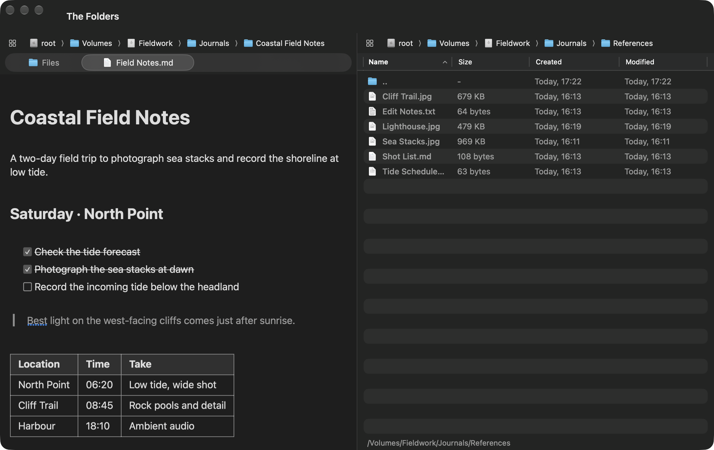
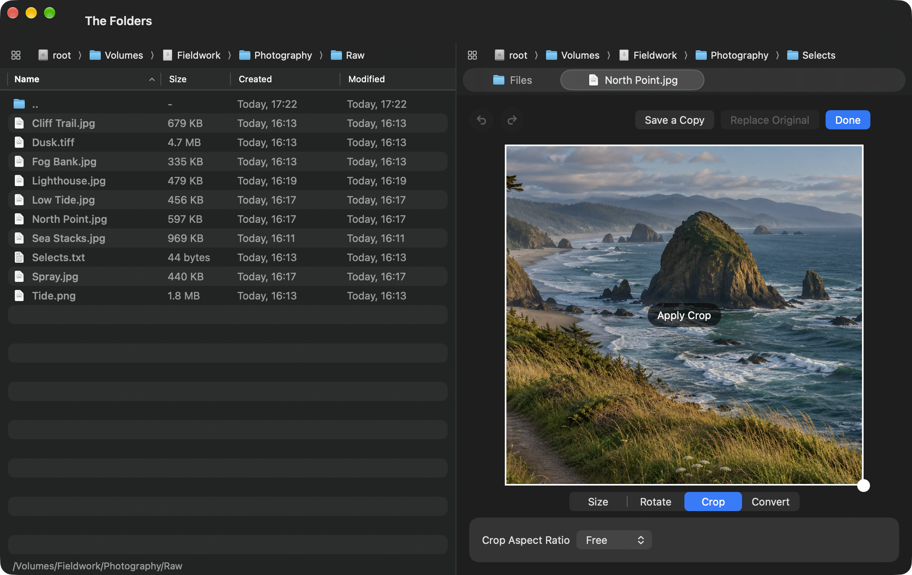

# The Folders — Dual-Pane macOS File Manager for Developers

The Folders is a dual-pane file manager for macOS developers. Browse project folders side by side, preview source code, edit Markdown, and see what takes up disk space.

[Download for macOS](https://github.com/timokhin/the-folders-releases/releases/latest) · [Website](https://timokhin.github.io/the-folders-releases/) · [Issue tracker](https://github.com/timokhin/the-folders-releases/issues)

## Tools for working with project files

### Side-by-side file management

Keep source files and build output open in separate panes. Drag files directly from one pane to the other.

### Keyboard-friendly navigation

Press Space to preview files and Command plus a number to switch tabs. Use shortcuts to copy or move files between panes.

### Source code and config previews

Read source code, JSON, YAML, and other text files in either pane. Keep several file and folder previews open in tabs.

### Dotfiles and Terminal

Keep selected hidden files visible by name or pattern, copy file paths, and open project folders in Terminal.

### Folder size and disk usage

See how much space a project folder uses and how that space is split across logs, caches, build artifacts, and other files.

### Markdown preview and editor

Edit README files, changelogs, and project notes in a formatted Markdown preview. See the markup at the cursor and follow links to local files.

### Image editor

Crop, resize, rotate, or flip an image right in its preview. Save your edits or export a copy in a different format.

### Built-in music player

Play a folder of local tracks as a playlist. See the album artwork, skip or shuffle tracks, and control playback from the toolbar as you browse.

## Download The Folders for macOS

Requires macOS 26.6 or later. The signed DMG is about 10 MB.

Free to evaluate. Continued use requires a paid license.

[View latest release](https://github.com/timokhin/the-folders-releases/releases/latest) · [The Folders Software License Agreement](license.md)
