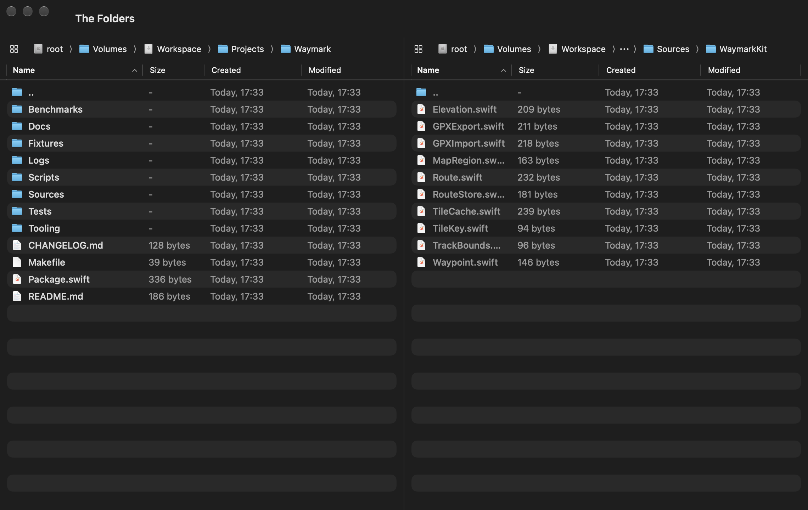
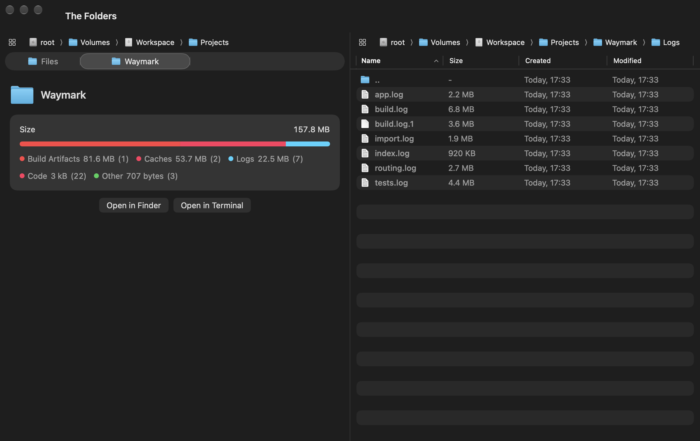
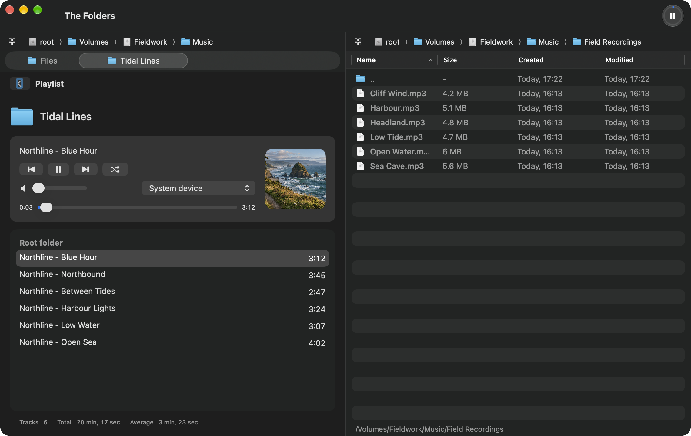

# The Folders

A little more room for your files. The Folders is a two-pane macOS file manager for developers. Browse project folders, edit Markdown, and see what’s taking up space.

[Download The Folders](https://github.com/timokhin/the-folders-releases/releases/latest) · [Website](https://timokhin.github.io/the-folders-releases/) · [Issue tracker](https://github.com/timokhin/the-folders-releases/issues)

## A closer look at your workspace

### File and folder sizes

Check file sizes and folder totals. The Folders detects logs, caches, and build artifacts and shows how much space each category takes up.

### Markdown preview and editor

Read and edit README files, changelogs, and project notes in one formatted Markdown preview. See the markup at the cursor and follow links to local files.

### Image editor

Crop, resize, rotate, or flip an image right in its preview. Save your edits or export a copy in a different format.

### Built-in music player

Play a folder of local tracks as a playlist. See the album artwork, skip or shuffle tracks, and control playback from the toolbar as you browse.

## Features

- **Two panes, one flow.** Keep source and build output side by side, and drag files between the panes.
- **Preview as you go.** Preview source files in either pane and keep several files or folders open in tabs.
- **Make it yours.** Customize settings and add the context menu commands you use in your workflow.

## Native and lightweight

Built for macOS for a fast, native experience that stays light on your system. The download is about **10 MB**, and The Folders uses little RAM.

## License

See the [The Folders Software License Agreement](license.md).
